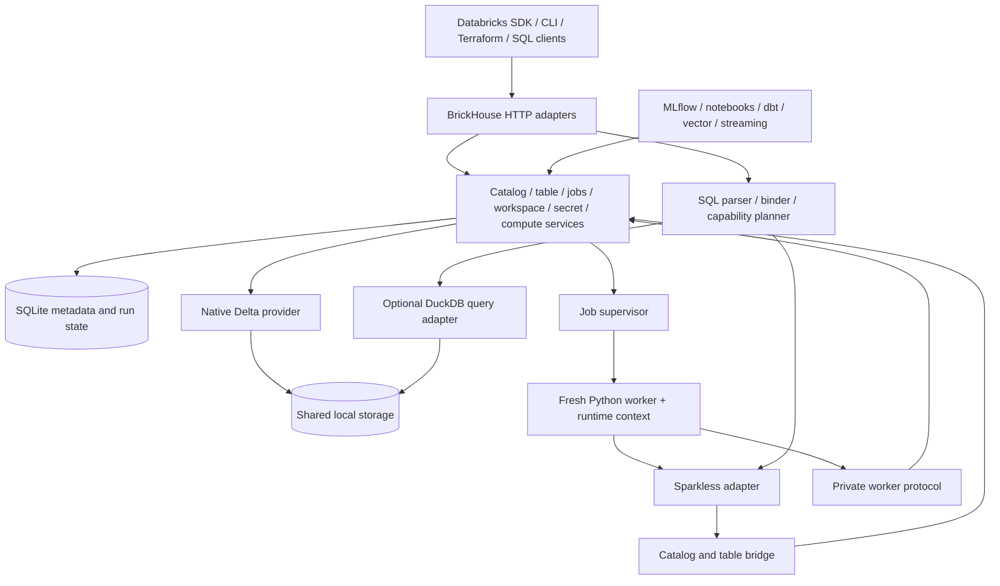

# 01 — Architecture

Status: target architecture with implemented local slices. B006.1–B006.3 implement local workspace bootstrap, POSIX ownership, the embedded lifecycle, and a loopback server. B007.1 adds schema-versioned catalog/schema IDs and local table-registration metadata repositories. B007.2 adds a local identifier resolver and fresh namespace state per caller. B007.3 adds a bounded local REST profile for pinned SDK catalog/schema operations. B008.1 defines provider-neutral table handles, Delta snapshot/schema/protocol descriptors, write validation, and owned local staging. B008.2–B008.4 add local delta-rs reads/writes, operation recovery and ownership-safe removal. B010.1–B010.3 bind internal Sparkless 4.15.0 sessions to registered, version-pinned Delta snapshots; route selected create/append/overwrite mutations through the common table service; and verify coexisting session state plus resolved serverless/classic-standard profile settings. B011.1–B011.6 add a selected SQL planner/executor, pinned SDK statement/result routes, simulated warehouse identities, and persistent admission bound to local execution. B011.3 now implements bound parameters, wait behavior and terminal cancellation against Sparkless 4.15.0; B011.4 result retention/chunks are complete. B021.2.1–B021.2.3 verify released connector session lifecycle, one SEA-mode inline query/result case, connector-visible errors, synchronous cancellation and bounded result lifetime. The kernel Arrow-stream default, other metadata methods, Thrift and remote Databricks compatibility remain unqualified. B018 now proves the dependent SDK job flow, lifecycle/isolation, seven selected compute selectors, all three local SQL warehouse readers, and separate base/notebook-extra installation lanes. Classic/warehouse resources are simulated; broader runtime semantics, other runtimes, released-connector behavior beyond the exact B021.2.1–B021.2.3 local cases, and Databricks API compatibility remain incomplete.

## System boundaries

Transport code validates wire requests and calls domain services. Domain services own invariants. Repositories own persistence. Execution providers return typed results. Job processes are consumers of these services, not additional authoritative catalogs.

## Future deployment boundary

The local JVM-free emulator remains primary. [Document 18](18-self-hosted-platform.md) and [ADR 0034](../decisions/0034-emulator-first-self-hosted-platform.md) preserve the current service direction while staging deployment after B049's stability gate. B048 reviews the actual local G1–G4 paths before B023: stable resource IDs and shared services; contained path/staging, interpreter/PID/signal/socket assumptions; and documented future identity entry points. This review adds no remote backend, generic provider framework or no-op security layer.

A future browser or remote transport calls the same domain services. A future worker pool keeps catalog metadata and commits in the authoritative control service; workers do not share a writable SQLite file or own a second catalog. Principal provenance, enforced authorization, authenticated worker leases and alternate data transport need their own later contracts and real tests. Current local locks, private pipes and process identity retain their tested scope; they do not implement distributed fencing.

SQLite with one local metadata owner remains valid for the initial deployment design. Replacing it, adding HA or distributing one query requires a separate need and evidence. Every future executor still runs without Java/Spark or hidden Databricks fallback.

## Optional native query distribution

[Document 19](19-sparkless-cluster-execution.md) separates Sparkless query/stage/partition scheduling from BrickHouse job placement and simulated compute metadata. A future native query coordinator consumes explicitly granted execution capacity; it does not become a second workspace scheduler, catalog or commit authority. Sparkless executors read provider-authorized pinned fragments and return winning output manifests to the owning table service. Current synchronous buffered provider hooks do not implement these contracts.

SC.0–SC.5 is an optional post-stability track; B062 integration requires both qualified engine artifacts B061 and remote-execution foundation B053. Local session/worker behavior and all existing emulator/self-hosting release requirements remain unchanged. No new runtime API, distributed storage or clustering capability is implied by this design.

## Authoritative state

| State | Authority |
|---|---|
| Catalog/schema/table identity, ownership, storage location | BrickHouse SQLite metadata |
| Table data, schema evolution, transaction version | Delta transaction log |
| Workspace/volume files | Configured local storage root |
| Job definitions, run state, task values, retry attempts | BrickHouse SQLite metadata |
| Cluster/warehouse identity, simulated infrastructure lifecycle, resolved compute/environment references | BrickHouse SQLite metadata through the workspace compute service |
| Session namespace, temporary views, session config, UDFs | Isolated engine session/worker |
| MLflow experiments/models | MLflow provider; BrickHouse stores references, not duplicate mutable copies |
| Vector index files and engine metadata | Vector provider, with lifecycle references in BrickHouse |

Minilake's managed DuckDB tables are not the physical-table model adopted here. Managed and external BrickHouse Delta tables both use actual Delta files; their ownership and deletion policies differ. DuckDB registrations are reconstructable query views of committed data. Do not let a cached DuckDB table become a second copy of truth.

## Module dependency direction

`api -> services -> ports/domain`; implementations of ports live in `persistence`, `storage`, `engines`, and `runtime`. Domain types cannot import FastAPI, Minilake, Sparkless native classes, or a cloud SDK. Python protocol contracts expose table handles, schema descriptors, Arrow streams, capability descriptors, and explicit errors.

The composition root creates an instance-scoped `WorkspaceContext`. `WorkspaceContext.new_namespace_state()` returns fresh current catalog/schema values for one future session; the workspace context does not hold those mutable values. Do not migrate Minilake module-global mutable dictionaries directly into shared BrickHouse server state. Multiple app instances in one interpreter must remain isolated.

## Deployment and process model

Default: one HTTP server, one metadata writer boundary, and configurable child job processes. SQLite is accessed through repositories in the server; workers use a scoped internal protocol for metadata, secrets, task values, table commits, and heartbeats. Local file access uses validated storage paths. B006.2 provides the POSIX advisory workspace-owner handle; B006.3 composes it into the embedded `WorkspaceContext` and CLI server. The CLI and both direct server entry points validate numeric IPv4 loopback before workspace acquisition, API-service construction, or socket binding. The server exposes `/health`, `/version`, `/capabilities`, catalog/schema routes, classic cluster lifecycle routes, Python source import, and a pinned-SDK subset for Python job create/submit/poll/output. It has no inbound authentication; loopback is not a multi-user authorization boundary. B014.3.1 dispatches up to ten tasks sequentially in topological order with persisted dependency gating; B014.3.2.1 adds bounded retries; B014.3.2.2 originally admitted up to four active workers; B064 supersedes that policy with at most two active attempts and eight persisted FIFO queued runs, enforcing each job's declared `max_concurrent_runs` (1–10) and returning HTTP 409 before creating history on overflow. B015 adds opt-in worker Sparkless sessions and registered-table reads. B018.1.1 adds a bounded Delta append from a worker through the parent table service; B018 verifies the integrated selected G2 workflow. The internal Sparkless session factory reads and writes selected registered local tables for embedded Python callers. B008.1 adds typed contracts/staging; B008.2–B008.4 provide the optional Delta service now composed into Sparkless, SQL, and worker writes. The `run` CLI command still reports that direct script execution is unavailable. The local SDK token is a compatibility value, not an authorization boundary.

The private worker protocol is separate from public Databricks endpoints, uses an unguessable run-scoped token, and is valid only for the worker's lifetime. Tokens and secret values are not passed in URLs or logged. Define internal messages with a schema/version and reject stale workers explicitly.

Each job attempt gets a fresh interpreter using `sys.executable` from a resolved environment, a working directory, immutable run context, and its own engine session. B016.1 uses a worker entry module to inject local `dbutils.fs` and widget helpers without mutating the parent interpreter. B016.3 sends task value requests over a per-attempt authenticated local socket; only the parent process accesses SQLite, and values are stored under run/task/attempt/key. The supervisor captures output, enforces timeout/cancellation, and persists state transitions. Process isolation limits state leakage; it is not a sandbox for hostile code. The DBFS compatibility root is `workspace/files/dbfs`; volume and mount namespaces remain separate future work.

## SQL and execution policy

Parse and bind before choosing an executor. Table/catalog DDL and DML route to their domain services. Sparkless is the semantic default for supported queries. DuckDB is an explicit capability-selected backend for tested operations; SQLGlot can translate an AST for it. Do not retry a failed Sparkless query in DuckDB, especially after a possible mutation.

Pin namespace, timezone, ANSI behavior, and statement snapshot policy at the execution boundary. Return schema and results through one typed result protocol regardless of executor. Arrow conversion is preferred; JSON row conversion may be a bounded temporary path for early fixtures, with no unmeasured zero-copy claim.

## Planned compute profiles

[Document 17](17-serverless-and-classic-compute.md) adds serverless/classic Python and notebook profiles and three SQL warehouse profiles. A workspace-scoped compute service resolves resource IDs and legal simulated lifecycle transitions; B011.5 implements the warehouse slice and B014.4 the classic slice. B014.5 resolves supported SDK selectors, provisioned environment/runtime mappings and settings into immutable attempt context before dispatch. SQL resolves its warehouse through the same service authority. Request models only validate transport shape.

Compute mode, access mode, reference runtime/environment and protocol are independent choices. Both modes target Sparkless and the same table/commit service, with the worker-facing surface still deliberately small. Each job attempt retains a fresh child process; shared cluster IDs do not imply shared Python/JVM state. Notebook state belongs to its kernel and is invalidated on reset/compute termination. B014.6 binds the seven selected Python job contexts to local worker/resource lifetimes and tests cancellation/reaping on all-purpose compute restart or termination. B015 adds opt-in worker Sparkless sessions and registered reads; B018 verifies the registered Delta append path across seven selected job compute profiles and reads its commit through all three local SQL warehouse profiles. B011.6 and B017.5 separately prove real statement/kernel effects after their resource/context tasks complete; [document 16](16-phase-0.1-initial-release.md) fixes the work order and release case matrix. Unknown resources, unsupported settings or unavailable environments fail explicitly. No full serverless/classic compatibility is established by this target architecture.

## Mutations and concurrency

All BrickHouse-owned table writes participate in a common table-service contract. Prefer one selected delta-rs implementation/version for mutations. A per-table lock serializes BrickHouse mutation requests initially; Delta optimistic concurrency remains necessary for writers outside that lock.

The embedded Sparkless adapter routes selected registered-table create/append/overwrite operations through the table service. A worker currently exposes only `format("delta").mode("append").saveAsTable()` for an existing registered table. Sparkless materializes an Arrow IPC stream capped at 32 KiB and 100,000 rows; the worker sends it through its attempt-authenticated 64 KiB service channel. The parent verifies table ID, canonical location, and expected Delta version, then commits through `DeltaRsTableService` with its operation journal and optimistic version check. Workers cannot create or overwrite tables, use arbitrary paths, configure writer options or partitions, or edit `_delta_log`. Larger or batch writes remain future work; they must preserve the same parent-owned commit contract.

## Failure boundaries

Metadata transactions and Delta commits cannot share a SQLite transaction. Use an operation journal with IDs, staged state, committed Delta version, and recovery reconciliation. Document orphan files and uncertain commits; never claim rollback of a Delta commit by deleting metadata. Cancellation and retries must consult the operation journal before reporting success or repeating a write.

On restart, reconcile incomplete metadata operations and child runs. Interrupted work must become recoverable or explicitly failed. Partial execution must never be reported as a successful completed job.
