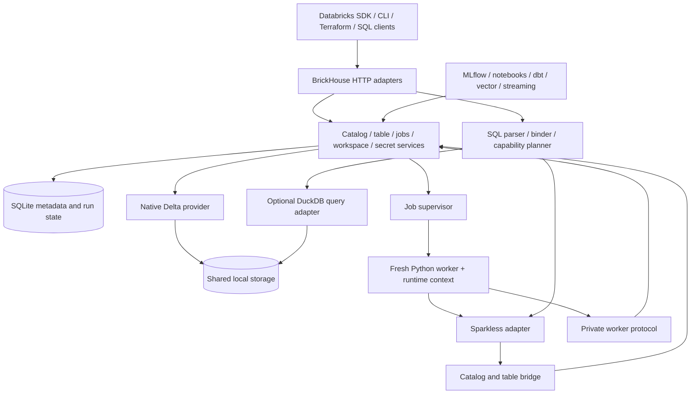

# 01 — Architecture

Status: proposed design; validate through M0 spikes before broad implementation.

## System boundaries

Transport code validates wire requests and calls domain services. Domain services own invariants. Repositories own persistence. Execution providers return typed results. Job processes are consumers of these services, not additional authoritative catalogs.

## Authoritative state

| State | Authority |
|---|---|
| Catalog/schema/table identity, ownership, storage location | BrickHouse SQLite metadata |
| Table data, schema evolution, transaction version | Delta transaction log |
| Workspace/volume files | Configured local storage root |
| Job definitions, run state, task values, retry attempts | BrickHouse SQLite metadata |
| Session namespace, temporary views, session config, UDFs | Isolated engine session/worker |
| MLflow experiments/models | MLflow provider; BrickHouse stores references, not duplicate mutable copies |
| Vector index files and engine metadata | Vector provider, with lifecycle references in BrickHouse |

Minilake's managed DuckDB tables are not the physical-table model adopted here. Managed and external BrickHouse Delta tables both use actual Delta files; their ownership and deletion policies differ. DuckDB registrations are reconstructable query views of committed data. Do not let a cached DuckDB table become a second copy of truth.

## Module dependency direction

`api -> services -> ports/domain`; implementations of ports live in `persistence`, `storage`, `engines`, and `runtime`. Domain types cannot import FastAPI, Minilake, Sparkless native classes, or a cloud SDK. Python protocol contracts expose table handles, schema descriptors, Arrow streams, capability descriptors, and explicit errors.

The composition root creates an instance-scoped `WorkspaceContext`. Do not migrate Minilake module-global mutable dictionaries directly into shared BrickHouse server state. Multiple app instances in one interpreter must remain isolated.

## Deployment and process model

Default: one HTTP server, one metadata writer boundary, and configurable child job processes. SQLite is accessed through repositories in the server; workers use a scoped internal protocol for metadata, secrets, task values, table commits, and heartbeats. Local file access uses validated storage paths.

The private worker protocol is separate from public Databricks endpoints, uses an unguessable run-scoped token, and is valid only for the worker's lifetime. Tokens and secret values are not passed in URLs or logged. Define internal messages with a schema/version and reject stale workers explicitly.

Each job attempt gets a fresh interpreter using `sys.executable` from a resolved environment, a working directory, immutable run context, and its own engine session. The supervisor captures output, enforces timeout/cancellation, and persists state transitions. Process isolation limits state leakage; it is not a sandbox for hostile code.

## SQL and execution policy

Parse and bind before choosing an executor. Table/catalog DDL and DML route to their domain services. Sparkless is the semantic default for supported queries. DuckDB is an explicit capability-selected backend for tested operations; SQLGlot can translate an AST for it. Do not retry a failed Sparkless query in DuckDB, especially after a possible mutation.

Pin namespace, timezone, ANSI behavior, and statement snapshot policy at the execution boundary. Return schema and results through one typed result protocol regardless of executor. Arrow conversion is preferred; JSON row conversion may be a bounded temporary path for early fixtures, with no unmeasured zero-copy claim.

## Mutations and concurrency

All BrickHouse-owned table writes participate in a common table-service contract. Prefer one selected delta-rs implementation/version for mutations. A per-table lock serializes BrickHouse mutation requests initially; Delta optimistic concurrency remains necessary for writers outside that lock.

Dataframe writers in workers stage Arrow or Parquet data in a run-owned location and request a commit from the table service. The service controls creation, append, overwrite, schema evolution, and idempotency. If an early prototype must use a Sparkless native writer directly, it must be confined to an isolated table and cannot satisfy the shared-write milestone until it uses the same commit contract.

## Failure boundaries

Metadata transactions and Delta commits cannot share a SQLite transaction. Use an operation journal with IDs, staged state, committed Delta version, and recovery reconciliation. Document orphan files and uncertain commits; never claim rollback of a Delta commit by deleting metadata. Cancellation and retries must consult the operation journal before reporting success or repeating a write.

On restart, reconcile incomplete metadata operations and child runs. Interrupted work must become recoverable or explicitly failed. Partial execution must never be reported as a successful completed job.
