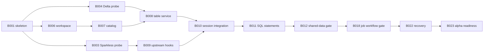

# 08 — Milestone roadmap

## Execution model

[The root ROADMAP.md](../../ROADMAP.md) groups this plan into release phases 0.1–0.9. Phase 0.1 ships initially as **0.1.0** and includes M0–M3 / B001–B023; M0 is internal foundation work within that initial release. Later phases split M4–M6 by outcome. Milestones remain engineering evidence gates, and release grouping does not change task prerequisites or acceptance criteria.

Milestones are evidence gates, not calendar estimates. Implement the smallest useful vertical slice, then expand behavior. Task dependencies live in [the task ledger](../../planning/tasks.json); acceptance criteria live in [the backlog](09-task-backlog.md). A later milestone can contain independent work, but cannot claim completion before its prerequisites and gates pass.

| Milestone | Outcome | Tasks | Exit evidence |
|---|---|---|---|
| M0 — Prove the foundation | Installable skeleton; decisions on native providers, upstream hooks, and client versions | B001–B005 | Dependency/wheel matrix; Minilake reuse inventory; runnable engine/Delta/client probes; personal-account reference profile and sanitized captures; decisions recorded |
| M1 — One coherent data workspace | Catalog, Sparkless, Delta, and SQL share real tables | B006–B012 | G1: write by DataFrame, read by SDK SQL and fresh session, restart and repeat; no JVM/cloud |
| M2 — Execute user workflows | Python jobs, workspace files, dbutils, optional notebooks | B013–B018 | G2: real SDK submission and dependent tasks produce persisted Delta output; isolation and error cases pass |
| M3 — Publishable local alpha | Reproducible installation, measured compatibility, failure recovery, selected clients | B019–B023 | G1–G4 for the declared alpha surface, clean-wheel install, supported platforms, versioned limitations |
| M4 — Broaden workspace services | Advanced jobs, ML, dbt, policy, vectors | B024–B029 | G6 per advertised extra; failures and lifecycle behavior demonstrated |
| M5 — Incremental and declarative data | Durable micro-batches, file discovery, batch pipelines, selected CDC/stateful behavior | B030–B035 | G5 with injected failures and explicit delivery/state guarantees |
| M6 — Broader protocols and platform | Connect, Thrift, feature engineering, sharing, platform gaps, performance | B036–B042 | Native client-to-engine workflows, expanded conformance report, no JVM fallback |

M4–M6 entries are epics. Decompose them into bounded tasks with concrete APIs and fixtures before coding. Several are independent branches; sequence by user demand and evidence rather than implementing every optional subsystem before improving core semantics.

## Critical path

This is an overview, not the complete dependency graph. B002 Minilake audit and B005 client research run independently after B001. No source is copied before its provenance decision. Native worker infrastructure can progress while a Sparkless artifact is being prepared.

B005 establishes occasional personal-account reference capture under [document 15](15-personal-databricks-verification.md), with decomposition before implementation. Later tasks reuse reviewed observations to design local tests and request a new bounded probe only for an unresolved behavior or relevant change. Missing reference configuration blocks that capture work, not independent ready tasks. Required milestone and release gates run locally; none requires a live Databricks run or a fresh capture on each invocation.

## Alpha boundary

The alpha's required workflow is the README golden path. Implement a narrow, published list of catalog/SQL/job/dbutils operations, then prove them end to end. Notebook support is an optional extra; a release can omit it only by explicitly revising its scope and documenting that limitation, not by marking B017 done without execution evidence.

B020 defines one small CLI/Terraform/bundle deployment workflow; its completion does not imply all provider resources work. B021 proves the SQL connector's REST mode for an exact client version or records a blocker and formally defers that claim. A failed probe is useful research but cannot count as supported client behavior.

Before release, choose the exact advertised surface in a release scope record. Deferred work stays planned/blocked with its evidence; update the milestone and dependency records transparently. No milestone is complete merely because an unimplemented requirement was hidden.

## Release gates

- Versioned capability report with tests and limitations for each advertised operation.
- One authoritative table visible across all advertised interfaces.
- Clean installation on each advertised Python/OS/architecture combination.
- Base workflow without Java, Spark, Docker, or remote compute; separate offline gate after provisioning.
- Durable restart and uncertain-commit handling, cancellation, bounded logs/results, and cleanup.
- Native dependency versions and third-party notices included.
- Documented backup/restore and migration behavior for the supported workspace version.

A release candidate is a local build and report. Publishing to PyPI/GitHub requires the owner's authorization at that stage. The initial release is version 0.1.0; later version targets follow the root release roadmap. A future 1.0 scope requires its own evidence-backed decision and does not automatically imply full Databricks emulation.
