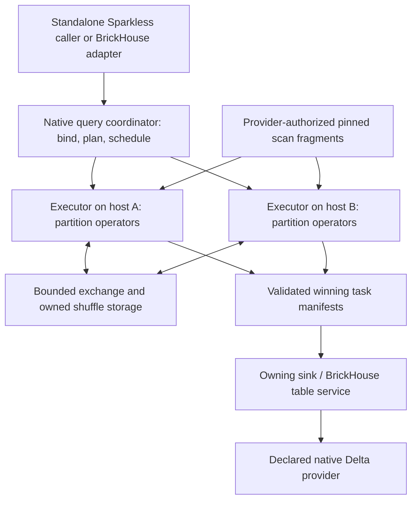

# 19 — Native Sparkless cluster execution

Updated: **2026-10-20**. Status: **future design, no cluster implementation or compatibility claim**. Planning task: B056. Decision: [ADR 0037](../decisions/0037-native-sparkless-cluster-plan.md). Source baseline and proposed upstream contracts: [Sparkless cluster work specification](../upstream/sparkless-cluster-contracts.md).

## Goal and priority

Expand Sparkless so one supported DataFrame/SQL query can execute partitions across multiple machines without Java, a Spark driver, Spark executors or a hidden remote Spark service. Preserve Sparkless's local mode as the default and preserve the selected Spark semantics across execution modes. A native Sparkless query coordinator is a new component, not an Apache Spark driver.

**The primary BrickHouse goal remains JVM-free Databricks emulation.** Phases 0.1–0.9 and SH.0–SH.6 retain their existing requirements. This document adds optional **SC.0–SC.5** stages after B049's emulator stability gate. They have no assigned release versions, dates or cluster-size promises. Planning is authorized now; no Sparkless files, release artifacts or cloud resources are changed by B056.

The [self-hosted plan](18-self-hosted-platform.md) already distinguishes remote job placement from distributing a query. SH.4/B053 runs independent jobs on remote workers; it can complete without this engine. SC.5/B062 integrates the cluster engine only after both B061's qualified upstream candidate and B053's authenticated remote-execution foundation. Neither B042 nor B055 depends on SC work. A useful single-server or remote-job deployment does not require a distributed query engine.

## Meaning of a cluster

| Capability | Meaning | Owner / boundary |
|---|---|---|
| Local parallel execution | Native work on one machine, within its actual memory/CPU limits | Existing Sparkless backend; no multi-host claim |
| Remote job pool | Separate Python jobs or notebooks placed on other machines | BrickHouse B053/SH.4; each job may still execute one local Sparkless session |
| Distributed query | A single bound query becomes partition/stage tasks, with exchanges and one query outcome | Generic Sparkless coordinator, native executors and protocols proposed here |
| Compatibility compute metadata | Databricks-shaped cluster/warehouse identity and simulated lifecycle | BrickHouse compute service; not proof of allocated hosts, partitioning or autoscaling |

A process pool that runs the entire query separately on each worker, or a coordinator that gathers all input before doing the real transformation, does not satisfy the distributed-query gate.

## Observed foundation and missing contracts

The clean Sparkless checkout was inspected read-only at **4.14.1 / `ad1b9445bad609ac4bf74d2cf3ad2f68832ff49b`**. Its adoption guide explicitly excludes a distributed scheduler/executors. Core backend traits and `ExprIr` are reuse candidates, not proof of a remote execution API. `PlanExecutor` consumes JSON row data and operations; external writes carry a buffered Arrow IPC byte vector. The Python session is marked owner-thread/unsendable. The inspected Python `repartition`/`coalesce` methods clone the inner frame rather than partitioning data. [The source specification](../upstream/sparkless-cluster-contracts.md) pins the exact files and distinguishes each observation from the proposed design.

Do not serialize Python sessions, Polars closures or process-local callbacks and call that a cluster protocol. Do not treat `serde` support on an expression as a complete typed, versioned physical plan. The existing provider hook and B010 local adapter remain valid for their recorded envelope; they do not implement bounded distributed scans, exchanges or sink manifests.

## Ownership and candidate design

Sparkless owns reusable logical/physical planning, partition operators, typed data exchange, task execution, query scheduling, cancellation and error/capability contracts. It must remain usable without BrickHouse or Databricks imports. BrickHouse owns public APIs, workspace identities and policy, jobs/notebooks, environment selection, table/catalog authority, mutation journal, deployment profiles and capability diagnostics. Deployment infrastructure enrolls machines and applies resource/isolation policy; the query scheduler schedules stage tasks within the capacity granted to a query. Avoid two competing resource allocators.

The proposed starting direction is **native Sparkless coordination and executors, with Polars executing supported partition-local operators**. This is a design hypothesis, not an implementation selection. SC.0 must compare extending that backend with a contained adapter to an existing native distributed engine, checking exact artifacts, licenses, typed plans, Spark semantics, cancellation and storage/commit integration. Python-only scheduling may be a prototype option if it transports typed plans/batches and keeps execution native. No alternative backend may silently replace Sparkless semantics or become a fallback after an error. Record the decision before implementation.

Logical responsibilities above are proposals; they need not be separate services or new distributions. Keep one Sparkless local package; a later cluster extra/binary/crate is justified only by a real installation boundary and tested version skew. No new empty extra, CLI syntax or public builder method is established here.

## Planning and execution contracts

### Bind once and describe physical work

Bind SQL/DataFrame plans through the existing semantic frontend. Resolve namespaces, parameters, timezone, ANSI settings, function versions and table identities at the declared analysis boundary. Pin each table scan to an exact committed snapshot and schema, with a provider-generated file/row-group or equivalent fragment list. Concurrent append must not cause different workers to read different versions. If storage retention removes a pinned file, report snapshot unavailability rather than reading latest.

The proposed versioned plan envelope carries query/session identity, plan/schema fingerprints, required capabilities and semantic settings, input snapshots, operator graph, partition/distribution requirements, ordering guarantees, environment/artifact digests, deterministic function information and execution limits. Typed literals must preserve decimal/date/timestamp/nested values; do not infer them from JSON numbers or strings. Unknown versions, operations, types and provider features fail before dispatch when detectable. Endpoint/credential material is separate from serializable plans and user diagnostics.

Build a physical stage DAG with explicit source, partition-local transform, partial aggregate, exchange, final aggregate/join, result and sink boundaries. Track required versus produced partitioning/order. SC.0 decides whether to extend existing engine traits with small ports or add contained physical-plan components; it must not promise that the current trait graph already captures all Python/DataFrame operations.

### First operator envelope

| Stage | Initial cases | Required negative/semantic cases |
|---|---|---|
| Partition-local | Pinned Parquet/Delta fragments; typed projection/filter; union with exact schemas | Missing snapshot/file, invalid expression/type, empty partitions, nested null validity, invalid credentials |
| Aggregation | Two-phase COUNT, SUM, MIN, MAX and AVG from explicit partial state | Null/empty semantics, decimal precision/widening/overflow, integer overflow/ANSI, floating reduction order; AVG must merge sum/count rather than average partial averages |
| Exchange and join | Versioned hash partitioning, repartition/coalesce, one supported inner equijoin; separately bounded broadcast option | Duplicate keys, null-key semantics, skew, same-key co-location, mixed version/hash rejection and exhausted spill/broadcast limits |
| Global operations | Explicit global LIMIT; bounded top-K or sort with a tested merge plan if selected | Per-partition limit is not a global ordered limit; reject unselected global/window/distinct/range operations |
| Sink | Append from validated winning output manifests; selected create/overwrite only after provider proof | Missing/duplicate/conflicting fragments, failed attempt output, stale generation, schema/protocol mismatch, cancel/commit race |

Freeze exact operations/types and oracle fixtures in SC.0 before coding. Start with the current verified BrickHouse typed envelope, then qualify each distributed operation separately. Map types, arbitrary Python UDFs, RDDs, Scala/JARs, JDBC/network side effects, streaming state, advanced windows, full MERGE and adaptive/skew optimization are initially unsupported unless explicitly added with tests. Do not pull every local Sparkless operation into the cluster denominator as supported.

Row order is unspecified without an ordering contract. Compare unordered results as multisets, preserving duplicates. Fix decimal intermediate/final types against reviewed oracles; do not relax exact types to obtain parallelism. Record floating-point tolerances and reduction-order limits for each selected operation. Nondeterministic functions must have a defined query/partition evaluation and retry policy or be rejected. No transparent coordinator-only fallback: an intentionally bounded global merge belongs in the physical plan and diagnostics.

### Batches, shuffle and memory

Use typed Arrow batches as a candidate interchange format, with exact nested validity, decimal precision, timezone and dictionary/schema rules. Arrow IPC is a data format, not by itself a flow-controlled network protocol. SC.0 selects transport using real bounded-transfer probes; it must specify protocol negotiation, message/batch/row limits, maximum in-flight bytes, byte credits/backpressure, checksums, compression limits, cancellation and deadline behavior. Never route bulk data through JSON rows, task values or the existing full-frame provider callback.

Hashing must be versioned and agree across workers for nulls, strings, timestamps, decimals, NaNs and signed zero under the selected equality semantics. Do not reuse a process-randomized hash. Exchange blocks identify query/stage/partition/attempt/generation, schema fingerprint, content hash, size and ownership. Publish a complete block manifest atomically; consumers cannot see partial output. Losing/retried outputs are fenced, and checksum/schema failures cannot turn into empty input.

Bound per-executor memory, concurrent partitions, result buffers, shuffle buffers and spill disk. Each partition must fit its declared operator policy or use a tested spill/recursive repartition strategy; multi-host execution alone does not make a hot key or oversized row safe. Broadcast joins require a measured byte cap. Start with fixed resources and explicit failure on unhandled skew. Stage cleanup must preserve live readers and commit-reconciliation evidence, and remove only owned artifacts after lease/retention checks.

### Scheduler, attempts and failure

Separate a BrickHouse job attempt from a Sparkless query and its stage/task attempts. The native query coordinator owns stage dependencies, capacity use, retry budgets and durable accepted-manifest state. Start without speculative execution, autoscaling or HA. Executors may be long-lived native agents only if query/session state is reset and proven isolated; each BrickHouse job still begins in a fresh child interpreter. Never share the same PyO3 session across host/thread boundaries.

Use coordinator-issued generations and leases for stage/task assignment, authenticated worker identities, heartbeats, deadlines and revocation. Accept one winning output per logical partition; duplicate completion cannot publish another output or commit. A failed producer invalidates unavailable shuffle blocks and recomputes from pinned inputs within a bounded policy. Do not retry nondeterministic/side-effecting operators without a declared policy. Cap attempts and total query work.

Cover executor death, partitioned networks, slow consumers, coordinator restart, stale events, corruption, disk-full, resource exhaustion and cancellation during scans/shuffle/sink. Initial coordinator restart may terminate queries truthfully and recover already accepted sink outcomes; transparent query resumption is a separate claim. Use durable fencing/lease expiry so old executors cannot publish after restart. Admission and query status must distinguish execution failure, interruption and unknown commit outcome. A missing task report is not success.

### Storage and commits

Sparkless requests reads/writes through a generic provider contract. For BrickHouse, the table service remains the catalog/commit authority and the declared native Delta provider performs every registered mutation. Workers receive only authorized snapshot/fragment capabilities, not broad metadata credentials or arbitrary storage-root access. Current canonical local paths need an explicit native URI/mount/transfer adaptation; Python filesystem support does not qualify Rust IO.

Distributed sinks stage immutable Arrow/Parquet fragments and return manifests to the owner. Bind operation identity to logical query/write intent, pinned input/target context, normalized plan/options/environment and the accepted logical output set. Manifest checksums identify physical bytes separately: a recomputation may produce different file bytes for equivalent rows. Once a commit intent is frozen, replay uses that exact accepted manifest; a changed manifest must not reuse its operation key blindly. An unresolved prior intent blocks replacement until reconciliation.

The table service validates task winners, lease/generation, fragment ownership/content/schema and complete partition coverage, then performs one logical provider commit and records the exact Delta version. Workers never independently append each retry or edit `_delta_log`. Do not claim that current delta-rs APIs ingest a multi-file manifest atomically without a bounded gather: SC.0/SC.3 must prove the provider extension or keep that sink unsupported. A coordinator gather can be a clearly bounded prototype sink but cannot satisfy the distributed bounded-write gate. Preserve current snapshot/feature restrictions until separately qualified.

Test failure before commit, commit-before-response and cancel concurrent with commit using actual files and provider transaction/history evidence. Reconcile before retry; uncertain outcomes remain uncertain. Exactly-once visible table effects apply only to the proved sink profile. External Python/network effects and multi-table mutations have no blanket transaction guarantee.

### Security and result lifecycle

SC.0's initial network threat model is explicitly enrolled machines within one administrative trust domain. Authenticate and encrypt coordinator/executor exchanges; validate size, nesting, plan and artifact digests before execution; keep credentials out of plans/logs/URLs. Freeze trusted executable versions instead of accepting arbitrary serialized Python/callables from the wire. Generic native workers still require OS isolation for hostile code. SC.5 inherits SH.3/SH.4's actual isolation, principal/data/secret scope and rotation tests.

Return bounded typed result streams with schema and execution diagnostics. `collect()` is an explicitly bounded gather at the caller; a large distributed dataset does not fit in caller memory by definition. Limit/stream/expire results with ownership and cancellation checks; report truncation only if a caller explicitly negotiates it. Explain output should show actual partition/stage placement, bytes, spill, retries and local/global work, separate from simulated Databricks cluster metadata. Metrics establish no speedup until measured.

## Stages and acceptance gates

All B057–B062 entries are future epics. Decompose before implementation under the actual Sparkless and BrickHouse repository instructions. These B IDs coordinate requirements in BrickHouse; they do not create upstream issues, commits, public APIs or releases. Implement generic engine work in Sparkless, retain its own linked task/test references, and integrate only via a versioned public artifact. Every implementation stage is transitively gated on B049.

| Stage / owner | Deliverable | Evidence gate |
|---|---|---|
| **SC.0 / B057** | Source refresh, options decision and finite distributed operator/semantic/transport/sink specification | K0: exact upstream source/artifacts/licenses, two-process typed plan/batch feasibility probes, partition/snapshot/commit gap decisions and a chosen initial threat/platform matrix; a negative result records a blocker and cannot count as implemented distributed execution |
| **SC.1 / B058** | Versioned physical plan, partition scans/operators and bounded local executor prototype | K1: one query uses at least two real executor processes, disjoint input fragments and typed exact results; unknown protocol/operator/schema and resource-limit cases fail; local Sparkless remains unaffected |
| **SC.2 / B059** | Real network exchanges and shuffle/global operators | K2: one query spans two actual hosts; cross-host hash aggregation/join sees overlapping keys and duplicate/null cases; backpressure, spill, skew bounds, checksum corruption and cancellation are exercised without gathering all inputs centrally |
| **SC.3 / B060** | Fenced attempts, recovery and provider-owned distributed sink | K3: crash/partition/restart/stale-task/duplicate/lost-response cases preserve one accepted partition output and actual table versions; prove native provider manifest commit or keep sink support blocked; failed/uncertain work is never successful |
| **SC.4 / B061** | Reviewable standalone Sparkless cluster candidate | K4: exact public API and compatible executor/plan/data versions, reproducible wheel/native artifact matrix, local regressions and K1–K3, security/resource/failure report, measured scale data and explicit limits; publication remains separate authorization |
| **SC.5 / B062** | Optional BrickHouse cluster adapter after B061 and B053 | K5: jobs and SQL use the same supported distributed plans and registered snapshots; writes go through one table service; apply principal/lease/isolation rules, real two-host results/failures and deployed gate regressions; a published compatible Sparkless artifact is required before any public BrickHouse cluster release |

K4 can qualify a hash-pinned source-built development candidate. It cannot claim that artifact is published or ready for normal user installation. If an upstream contract is missing, keep its consumer blocked and continue independent emulator/self-hosting work.

## Finite qualification corpus and limits

SC.0 freezes versioned fixtures and numeric settings before implementation: at least two executors, initially two actual hosts for K2 onward, fixed worker resources and no autoscaling. Specify batch bytes/rows, in-flight bytes per peer/query, spill quotas, input/partition skew, result caps, concurrency/admission, attempt budgets, timeouts and cleanup policy in the case manifest. Those future fixture settings are not current config or Databricks defaults.

| Family | Required proof |
|---|---|
| Q01 | Local-versus-cluster projection/filter/union/count/group results over shared typed fixtures, with partition boundaries through null/decimal/date/timestamp/list/struct rows |
| Q02 | Keys overlap across workers, so aggregate partial/final and join exchanges are necessary; duplicate rows/keys and empty partitions remain correct |
| Q03 | Append/overwrite arriving during scan does not change the pinned read; unreadable/expired snapshots fail explicitly |
| Q04 | Multi-batch results, producer pressure, spills, hot keys and oversized rows respect measured budgets; one coordinator cannot hold all source/intermediate data |
| Q05 | Worker/network/coordinator failures, cancellation and stale/duplicate completion preserve truthful attempts, accepted outputs and cleanup |
| Q06 | One logical sink commit across partitions/retries, changed-output rejection and commit-before-response reconciliation; exact schema/history/version visible from SQL and a fresh session |
| Q07 | Invalid plan/version/hash/environment, unauthorized fragment/result access and expired worker credentials fail with no data leakage or execution substitution |
| Q08 | Single-node overhead and one/two/more-worker benchmarks record hardware, data/skew, network, bytes/spill and variance; demonstrate added aggregate capacity before claiming scale or speedup |
| Q09 | Local install/workflow without a coordinator, deployment runtime or network remains intact; native process/dependency/network checks prove no JVM or Spark fallback |

These are planned families, not test IDs. Compare to reviewed stored Spark/Databricks semantic fixtures where available; a cluster/local match alone can reproduce the same local bug. New reference probes are optional under document 15, never required live CI. Cross-host infrastructure must be explicitly available and authorized; this plan creates no cloud budget. No full Sparkless rebuild or cloud workload is needed to write these documents.

## Deferred scope

Defer arbitrary Python UDF shipment, streaming state migration, full SQL/operator parity, heterogeneous CPU/OS workers, elastic autoscaling, speculative execution, coordinator HA and distributed multi-table transactions until separate evidence-backed slices. SC.0 chooses a homogeneous supported artifact/platform matrix first. Existing Spark Connect work is a client protocol; it does not supply this execution backend automatically.

Record engine-distribution support independently from Databricks compatibility and self-hosted operations. C065–C067 start planned without tested versions or evidence. [The upstream work specification](../upstream/sparkless-cluster-contracts.md) maps missing hooks and first failing tests; the ledger/backlog and [roadmap](../../ROADMAP.md) own stage readiness.

## B063 native infrastructure comparison

[Document 20](20-open-source-reuse.md) and [its source inventory](../upstream/oss-reuse-inventory.md) identify concrete **Ballista 55.0.0 / DataFusion 55.0.0** and **Delta Kernel 0.30.0** research candidates. SC.0/B057 must compare these native building blocks with extending the Sparkless/Polars path before choosing to implement equivalent scheduler/exchange infrastructure. Record semantic/typed-plan/provider-commit/security fit and actual cost of adapting public APIs. Ballista's Rust 1.94 requirement differs from the inspected Sparkless 1.93 baseline, so compare separate executable versus in-process boundaries explicitly.

This is not a backend selection or default-engine change. Existing Sparkless semantics, table authority, K0–K5 and B049/B061/B053 barriers remain. Kernel source does not prove an atomic bounded distributed manifest sink, and a DataFusion plan cannot silently replace a Sparkless query after failure. Retain exact version/Arrow/toolchain and public artifact evidence before qualification.
